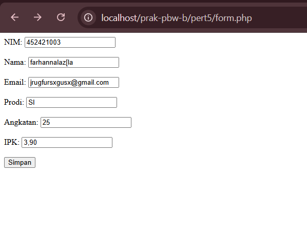
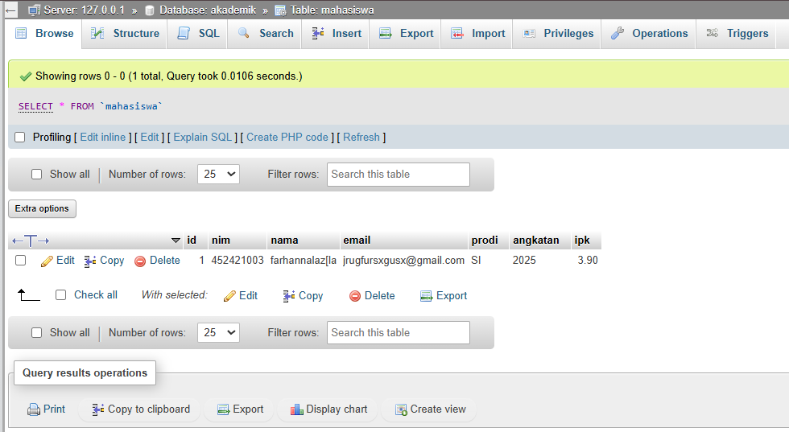
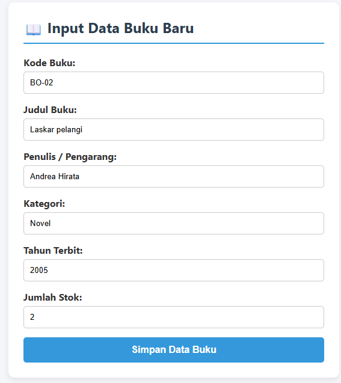
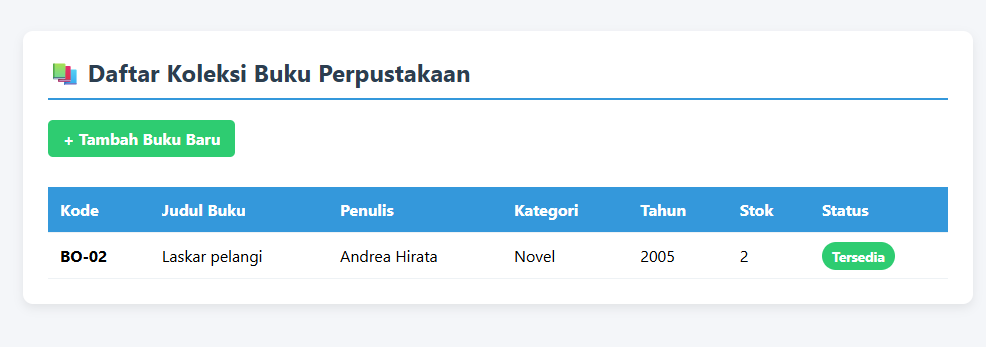
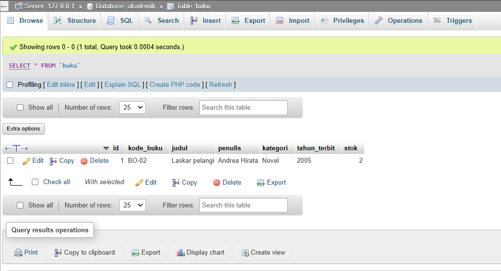
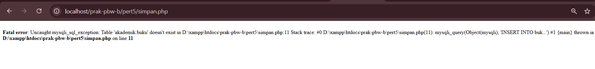

<div align="center">

# 📚 LAPORAN TUGAS PRAKTIKUM PEMROGRAMAN BERBASIS WEB (PERTEMUAN 5)
### Studi Kasus: Sistem Manajemen Data Buku Perpustakaan


</div>

---

### 👤 Identitas Praktikan
| Detail | Keterangan |
| :--- | :--- |
| **Nama** | Farhan Ridwan Badhawi |
| **NIM** | 4524210037 |
| **Kelas** | PBW-B |


---

## 📌 1. Modifikasi Bermakna pada Program

Pada praktikum kali ini, dilakukan **dua modifikasi utama** pada studi kasus Sistem Perpustakaan:

1. **Logika Kondisi Status Stok Buku (Business Logic)**
   * Menambahkan pengecekan kondisi `if ($data['stok'] > 0)` pada `data.php` untuk menampilkan indikator status visual secara dinamis (Badge Hijau `Tersedia` jika stok ada, dan Badge Merah `Habis` jika stok kosong).

2. **Pengembangan Tampilan UI Modern (CSS Card & Data Table)**
   * Mengubah tampilan form input bawaan menjadi *card interface* berbayang dengan struktur tombol yang responsif di `form.php`.
   * Mengubah tabel data polos menjadi *data table* modern berbasis CSS dengan efek *hover* baris dan penataan header yang kontras di `data.php`.

---

## 🔍 2. Penjelasan 5 Bagian Kode Paling Penting

> [!NOTE]
> Berikut 5 potongan kode yang paling penting untuk menjadi fondasi utama alur kerja sistem perpustakaan ini beserta penjelasannya:

### 1. Inisialisasi Koneksi Database (`koneksi.php`)
```php
$koneksi = mysqli_connect($host, $user, $password, $dbname, $port);
```
**Penjelasan & Fungsi**: Baris ini berfungsi membuka jalur komunikasi antara script PHP dan server MySQLi menggunakan kredensial parameter host (`127.0.0.1`), username, password, port `3306`, serta nama basis data `akademik`. Tanpa fungsi ini, PHP tidak dapat berinteraksi dengan database.

### 2. DDL Pembuatan Tabel Buku (`setup.php`)
```php
$sqlCreateTable = "CREATE TABLE IF NOT EXISTS buku (
    id BIGINT UNSIGNED AUTO_INCREMENT PRIMARY KEY,
    kode_buku VARCHAR(20) NOT NULL UNIQUE,
    judul VARCHAR(150) NOT NULL,
    penulis VARCHAR(100) NOT NULL,
    kategori VARCHAR(50) NOT NULL,
    tahun_terbit YEAR NOT NULL,
    stok INT UNSIGNED DEFAULT 0
) ENGINE=InnoDB";
```
**Penjelasan & Fungsi**: Sintaks SQL DDL (*Data Definition Language*) ini berguna untuk membuat struktur tabel `buku` secara otomatis jika belum ada di database. Kolom `id` diset sebagai *primary key auto-increment*, dan `kode_buku` diset *unique* agar tidak ada data buku ganda.

### 3. Penangkapan Input Form via Method POST (`simpan.php`)
```php
$kode_buku    = $_POST['kode_buku'];
$judul        = $_POST['judul'];
$penulis      = $_POST['penulis'];
$kategori     = $_POST['kategori'];
$tahun_terbit = $_POST['tahun_terbit'];
$stok         = $_POST['stok'];
```
**Penjelasan & Fungsi**: Bagian ini menangkap seluruh nilai elemen input yang dikirimkan oleh pengguna melalui form HTML di `form.php` menggunakan method `POST`. Variabel superglobal `$_POST` memastikan data dikirim secara aman melalui HTTP body tanpa terlihat pada URL browser.

### 4. Eksekusi Query Insert Data (`simpan.php`)
```php
$query = mysqli_query(
    $koneksi,
    "INSERT INTO buku (kode_buku, judul, penulis, kategori, tahun_terbit, stok)
     VALUES ('$kode_buku', '$judul', '$penulis', '$kategori', '$tahun_terbit', '$stok')"
);
```
**Penjelasan & Fungsi**: Perintah `mysqli_query` menyatukan objek koneksi dan query SQL DML (*Data Manipulation Language*) untuk merekam data buku baru yang sudah ditangkap variabel PHP langsung ke dalam baris tabel `buku` di database MySQL.

### 5. Fetch Data Iteratif & Conditional Badge Status (`data.php`)
```php
<?php while ($data = mysqli_fetch_assoc($query)): ?>
    <tr>
        ...
        <td>
            <?php if ($data['stok'] > 0): ?>
                <span class="badge badge-success">Tersedia</span>
            <?php else: ?>
                <span class="badge badge-danger">Habis</span>
            <?php endif; ?>
        </td>
    </tr>
<?php endwhile; ?>
```
**Penjelasan & Fungsi**: Perulangan `while` dengan `mysqli_fetch_assoc` menarik setiap baris data hasil query database satu per satu sebagai array asosiatif. Di dalamnya terdapat logika pengkondisian `if-else` untuk mengecek jumlah stok; jika stok di atas 0 akan memunculkan badge hijau "Tersedia", dan jika 0 akan menampilkan badge merah "Habis".

---

## 📸 3. Bukti Eksekusi Program (Screenshots)

### 🔹 Sebelum Modifikasi
*(Tampilan awal kode/output form mentah bawaan praktikum)*




### 🔹 Sesudah Modifikasi
*(Tampilan Form Input, Tabel Koleksi Buku Modern, dan Bukti Database phpMyAdmin)*






---

## 🛠️ 4. Penanganan Kendala (Error & Fix)




| Kategori | Detail Permasalahan | Solusi & Langkah Perbaikan |
| :--- | :--- | :--- |
| **Pesan Error** | `Fatal error: Uncaught mysqli_sql_exception: Table 'akademik.buku' doesn't exist` | Tabel `buku` belum pernah dibuat di database `akademik` saat perintah insert dijalankan. |
| **Penyebab & Solusi** | Terjadi karena script penyimpanan dipanggil sebelum DDL table dieksekusi. | Menjalankan file **`setup.php`** terlebih dahulu via browser (`localhost/prak-pbw-b/pert5/setup.php`) agar tabel `buku` terbuat secara otomatis. |

---

<div align="center">
  <sub>Dibuat untuk Tugas Laporan Praktikum Pemrograman Berbasis Web - 2026</sub>
</div>