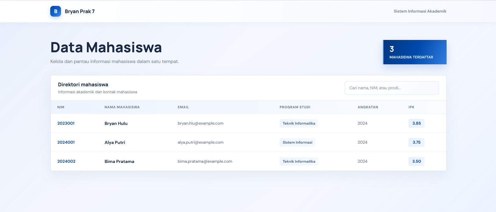
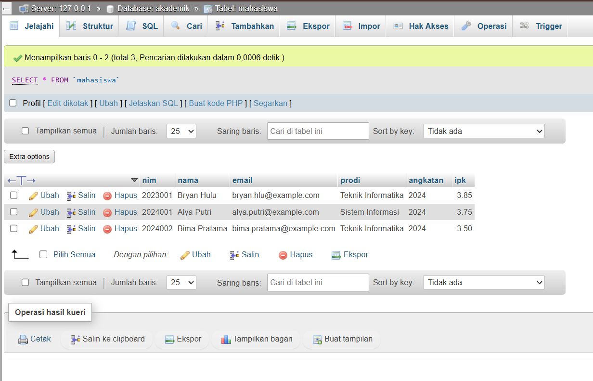

# Aplikasi Akademik MVC

Aplikasi PHP sederhana untuk menampilkan direktori mahasiswa dari database MySQL.

## Fitur

- Menampilkan jumlah dan daftar mahasiswa.
- Mencari mahasiswa berdasarkan isi tabel.
- Menampilkan NIM, nama, email, program studi, angkatan, dan IPK.

## Teknologi

- PHP
- MySQL
- MySQLi
- HTML dan CSS

## Struktur folder

```text
akademik-mvc/
├── index.php
├── koneksi.php
├── controllers/
│   └── MahasiswaController.php
├── models/
│   └── MahasiswaModel.php
├── views/
│   └── mahasiswa/
│       └── index.php
└── assets/
    ├── css/
    │   └── mahasiswa.css
    └── img/
        ├── dashboard-akademik.png
        └── database-akademik.png
```

## Menyiapkan database

Buat database dan tabel berikut melalui MySQL atau phpMyAdmin:

```sql
CREATE DATABASE akademik
    CHARACTER SET utf8mb4
    COLLATE utf8mb4_unicode_ci;

USE akademik;

CREATE TABLE mahasiswa (
    nim VARCHAR(20) NOT NULL PRIMARY KEY,
    nama VARCHAR(100) NOT NULL,
    email VARCHAR(150) NOT NULL,
    prodi VARCHAR(100) NOT NULL,
    angkatan YEAR NOT NULL,
    ipk DECIMAL(3, 2) NOT NULL
);
```

Konfigurasi koneksi bawaan di `koneksi.php` menggunakan host `127.0.0.1`, port `3306`, pengguna `root`, tanpa kata sandi, dan database `akademik`. Sesuaikan variabel koneksi tersebut bila konfigurasi MySQL berbeda.

## Menjalankan aplikasi

Jalankan server PHP dari folder `prak7`:

```bash
php -S localhost:8080
```

Buka [http://localhost:8080/akademik-mvc/](http://localhost:8080/akademik-mvc/) di browser. Jika menggunakan Apache XAMPP, letakkan proyek di document root Apache dan buka folder `akademik-mvc` melalui alamat lokal.

## Screenshot

### Halaman direktori mahasiswa



### Tabel mahasiswa di phpMyAdmin


