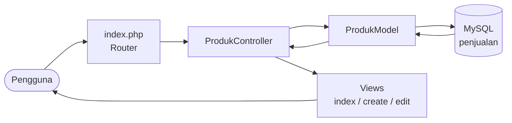
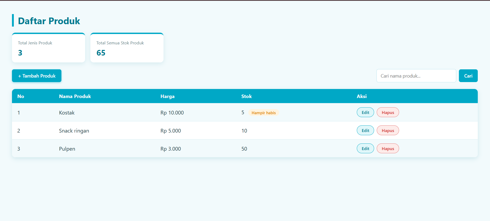
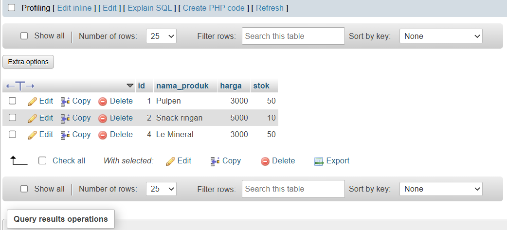
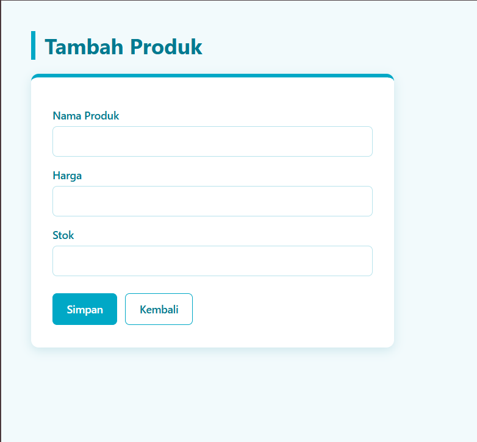

<div align="center">
# 🛒 Penjualan MVC
 
**Aplikasi CRUD Produk dengan PHP Native, MySQL, dan Pola MVC**
 


 
*Tugas Praktikum Pemrograman Berbasis Web (PBW), Pertemuan 7: MVC*
 
</div>
---
 
## 👤 Identitas
 
| | |
|---|---|
| **Nama** | _isi nama kamu_ |
| **NIM** | _isi NIM kamu_ |
| **Kelas** | _isi kelas, mis. PBW-B_ |
| **Mata Kuliah** | Pemrograman Berbasis Web |
 
---
 
## 📖 Deskripsi
 
Proyek ini adalah aplikasi manajemen produk untuk database penjualan. Kode disusun dengan pola **MVC (Model, View, Controller)** supaya logika database, alur program, dan tampilan terpisah dengan rapi.
 
Sesuai ketentuan tugas:
 
1. Membuat kode dan output MVC sesuai struktur folder.
2. Membuat database untuk menampung input program.
3. Menyertakan screenshot hasil tugas.
---
 
## ✨ Fitur
 
| Fitur | Keterangan |
|---|---|
| 📋 **Daftar Produk** | Menampilkan semua produk dalam tabel |
| ➕ **Tambah Produk** | Form untuk menyimpan data baru ke database |
| ✏️ **Edit Produk** | Form berisi data lama, dan perubahan disimpan ke database |
| 🗑️ **Hapus Produk** | Dengan konfirmasi dan memakai method POST |
| 🔍 **Pencarian** | Cari produk berdasarkan nama |
| 📊 **Ringkasan** | Total jenis produk dan total stok |
| 🏷️ **Badge Stok** | Label "Hampir habis" (stok ≤ 5) dan "Habis" (stok 0) |
| 🔔 **Toast Notifikasi** | Pop up sukses yang hilang otomatis setelah 3 detik |
 
---
 
## 🧰 Teknologi
 
- **PHP** (native, tanpa framework)
- **MySQL** lewat **XAMPP** (Apache + MySQL)
- **phpMyAdmin** untuk mengelola database
- **HTML + CSS** untuk tampilan, dengan palet utama `#00A8C6`
- **Antigravity IDE** sebagai editor kode
### 🎨 Palet Warna
 
| Peran | Warna | Kode |
|---|---|---|
| Utama | 🟦 | `#00A8C6` |
| Hover / Judul | 🟦 | `#007A91` |
| Aksen Muda | 🟦 | `#E0F7FA` |
| Latar Halaman | ⬜ | `#F2FAFC` |
| Teks Gelap | ⬛ | `#1F3A44` |
 
---
 
## 📁 Struktur Folder
 
```
penjualan-mvc/
├── index.php                  ← Router utama
├── koneksi.php                ← Koneksi database
├── controllers/
│   └── ProdukController.php   ← Alur program
├── models/
│   └── ProdukModel.php        ← Query database
└── views/
    └── produk/
        ├── index.php          ← Daftar produk
        ├── create.php         ← Form tambah
        └── edit.php           ← Form edit
```
 
### 🔄 Alur MVC
 

 
| Lapisan | File | Tugas |
|---|---|---|
| **Model** | `ProdukModel.php` | Berhubungan langsung dengan database (query SQL) |
| **View** | `views/produk/*.php` | Menampilkan HTML ke pengguna |
| **Controller** | `ProdukController.php` | Menerima request, memanggil model, memilih view |
| **Router** | `index.php` | Membaca parameter `aksi` lalu memanggil method controller |
 
---
 
## 🗄️ Database
 
**Nama database:** `penjualan`  **Tabel:** `produk`
 
| Kolom | Tipe | Keterangan |
|---|---|---|
| `id` | INT, AUTO_INCREMENT | Primary key |
| `nama_produk` | VARCHAR(100) | Nama produk |
| `harga` | INT | Harga produk |
| `stok` | INT | Jumlah stok |
 
```sql
CREATE DATABASE penjualan;
USE penjualan;
 
CREATE TABLE produk (
    id INT AUTO_INCREMENT PRIMARY KEY,
    nama_produk VARCHAR(100) NOT NULL,
    harga INT NOT NULL,
    stok INT NOT NULL
);
 
INSERT INTO produk (nama_produk, harga, stok) VALUES
('Pulpen', 3000, 50),
('Buku Tulis', 7000, 30);
```
 
---
 
## 🚀 Cara Menjalankan
 
1. Install dan buka **XAMPP**, lalu **Start** modul **Apache** dan **MySQL**.
2. Letakkan folder `penjualan-mvc` di dalam `C:\xampp\htdocs\`.
3. Buka `http://localhost/phpmyadmin`, lalu jalankan SQL di atas pada tab **SQL**.
4. Cek pengaturan di `koneksi.php` (default XAMPP: user `root`, password kosong).
5. Buka di browser:
```
http://localhost/penjualan-mvc/
```
 
> Sesuaikan URL dengan lokasi folder kamu. Contoh: `http://localhost/prak-pbw-b/pert7/penjualan-mvc/`
 
---
 
## 🛠️ Langkah Pengerjaan
 
### Step 1: Membuat Database dan Tabel
Membuat database `penjualan` dan tabel `produk` lewat phpMyAdmin dengan kolom `id`, `nama_produk`, `harga`, dan `stok`.
 
### Step 2: `koneksi.php`
Menghubungkan aplikasi ke MySQL memakai `mysqli_connect()`.
 
```php
$koneksi = mysqli_connect("localhost", "root", "", "penjualan");
```
 
### Step 3: `ProdukModel.php`
Berisi semua query: `getAll()`, `getById()`, `insert()`, `update()`, `delete()`, dan `getRingkasan()`. Input diamankan dengan `mysqli_real_escape_string()` dan casting `(int)`.
 
### Step 4: `ProdukController.php`
Menghubungkan Model dan View lewat method `index()`, `create()`, `edit()`, dan `hapus()`. Setelah aksi berhasil, pengguna diarahkan kembali ke daftar dengan parameter `pesan`.
 
### Step 5: Views
- `index.php`: tabel produk, pencarian, ringkasan, badge stok, tombol Edit dan Hapus
- `create.php`: form tambah produk
- `edit.php`: form edit dengan data lama sudah terisi
### Step 6: `index.php` (Router)
Membaca `?aksi=` dari URL, lalu memanggil method controller yang sesuai.
 
| URL | Fungsi |
|---|---|
| `index.php` atau `?aksi=index` | Daftar produk |
| `?aksi=create` | Form dan simpan produk baru |
| `?aksi=edit&id=1` | Form dan simpan perubahan produk |
| `?aksi=hapus` (POST) | Hapus produk |
 
### Step 7: Pengujian dan Screenshot
Menguji seluruh alur tambah, edit, hapus, dan pencarian, lalu mengambil screenshot sebagai bukti.
 
### Step 8: Percantik Tampilan dan Fitur Tambahan
- Tampilan dipercantik dengan palet `#00A8C6` tanpa mengubah struktur kode
- Menambah tombol **Hapus**, **pencarian**, **ringkasan**, dan **badge stok**
- Mengganti pesan sukses menjadi **toast** yang hilang otomatis
---
## 📸 Hasil / Screenshot
 
### 1. Halaman Daftar Produk

 
### 2. Database di phpMyAdmin

 
### 3. Halaman Tambah Produk


<div align="center">
Dibuat untuk memenuhi tugas praktikum **Pemrograman Berbasis Web**
 
</div>
